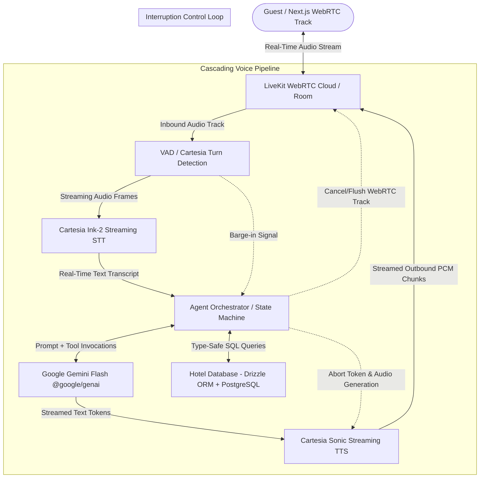

# Project Naina: Voice AI Agent for Hotel Management

> **Document Type:** Project Scope, Requirements & System Specification  
> **Status:** Draft for Review & Architectural Alignment  
> **Target Architecture:** Modular Cascading Voice AI Pipeline  
> **Repository Format:** Monorepo  

---

## 1. Executive Summary & Vision

**Naina** is a production-ready, conversational Voice AI Agent designed specifically for the hospitality industry (Hotel Management & Guest Services). 

The system acts as an intelligent virtual front-desk concierge capable of answering guest inquiries, managing room bookings and reservations, retrieving folio and billing details, and executing hotel operations in real-time through natural voice conversations.

### Dual Project Goals
1. **Production-Ready Engineering:** Build a robust, low-latency, modular voice agent capable of handling multi-turn conversations, interruptions (barge-in), tool calling (database/PMS integrations), and error recovery.
2. **Mentorship & Learning Journey:** Serve as a transparent, first-principles educational foundation. Every component, design trade-off, latency budget, and protocol will be explained step-by-step so you master the fundamentals of modern Voice AI.

---

## 2. Core Voice AI Terminology & Behind-the-Scenes Architecture

Because this is your first Voice AI project, understanding the fundamental pipeline and terminology is essential before making technical choices.

### 2.1 The Two Voice AI Paradigms
* **Speech-to-Speech (S2S / End-to-End):** A single multimodal neural network (e.g., Gemini Live, GPT-4o Audio) receives raw audio and outputs raw audio directly.
* **Cascading Architecture (Chosen Approach):** A modular pipeline where audio is decomposed into separate discrete stages:
  $$\text{Audio In} \longrightarrow \text{VAD} \longrightarrow \text{STT} \longrightarrow \text{LLM / Tools} \longrightarrow \text{TTS} \longrightarrow \text{Audio Out}$$

### 2.2 Why a Cascading Pipeline?
* **Modularity:** Swap any component independently (e.g., switch STT provider from Deepgram to Whisper without touching the LLM or TTS).
* **Control & Safety:** Direct inspection and validation of transcriptions, deterministic function calling, guardrails, and business logic before speaking.
* **Cost & Observability:** Granular tracking of cost and latency per stage (STT, token generation, audio synthesis).

### 2.3 Key Terms You Must Know
* **VAD (Voice Activity Detection):** Algorithms (such as Silero VAD) that detect human speech presence vs. ambient noise and silence. VAD determines when the user starts and stops talking (End of Utterance).
* **STT / ASR (Speech-to-Text / Automatic Speech Recognition):** Transcribes streaming audio frames into text in real-time (e.g., Deepgram Nova-2, Whisper).
* **LLM Orchestrator (The "Brain"):** Processes user text, maintains conversational context, executes function/tool calls against hotel databases, and generates conversational text responses.
* **TTS (Text-to-Speech / Speech Synthesis):** Converts LLM-generated text tokens into natural-sounding audio streams (e.g., Cartesia, ElevenLabs, Deepgram Aura).
* **Barge-in / Interruption:** The ability of the agent to instantly halt TTS audio playback and flush pending buffers when the user begins speaking mid-sentence.
* **Turn Detection & EOU (End of Utterance):** Determining whether a pause is natural mid-sentence thinking (e.g., "I'd like to book... uh... a suite") or the end of a question.
* **Latency Budget (TTFT & TTFB):**
  * **TTFT (Time To First Token):** Time taken by the LLM to emit the first word.
  * **TTFB (Time To First Byte / Chunk):** Time elapsed before the first audible sound chunk reaches the user's speaker.
  * **Target Total Conversational Latency:** $\le 800\text{ms}$ for natural, conversational human pacing.

---

## 3. High-Level System Architecture



---

## 4. Requirements Specification

### 4.1 Functional Requirements (FR)

#### FR-1: General Hotel Inquiries & Concierge (FAQ & Information)
* **FR-1.1:** Answering hotel policies (Check-in/Check-out times, pet policies, parking rates, cancellation terms).
* **FR-1.2:** Describing hotel amenities (pool, gym, spa, executive lounge, business center, operating hours).
* **FR-1.3:** Dining & Room Service (restaurant cuisines, breakfast timings, room service menu details).
* **FR-1.4:** Local Area Recommendations (nearby attractions, transport, airports).

#### FR-2: Room Inquiries, Bookings & Reservations
* **FR-2.1 Check Availability:** Query available room types (Deluxe, Suite, Standard) for given check-in/out dates and guest counts.
* **FR-2.2 Pricing Quotes:** Provide accurate nightly rates, taxes, and promotional packages.
* **FR-2.3 Reservation Creation:** Collect guest name, contact details, dates, room preference, and generate a reservation record with a booking reference ID.
* **FR-2.4 Booking Management:** Retrieve, modify dates, or cancel an existing reservation using booking reference and customer verification.

#### FR-3: Billing & Folio Services
* **FR-3.1 Folio Inquiry:** Verify guest identity (room number + last name or booking ID) and state current outstanding balance and itemized charges.
* **FR-3.2 Payment Link Dispatch:** Trigger simulated/actual payment link via SMS/Email for checkout or advance deposit.
* **FR-3.3 Digital Receipt Delivery:** Dispatch checkout invoice/receipt to the guest's verified email.

#### FR-4: Conversational Intelligence & Flow Management
* **FR-4.1 Context Memory:** Maintain conversational state across multiple turns (remembering guest dates, room selection, and name throughout the call).
* **FR-4.2 Disambiguation:** Ask clarifying questions when guest intent is incomplete (e.g., "For how many nights will you be staying with us?").
* **FR-4.3 Human Escalation / Hand-off:** Seamlessly recognize when a guest requires a human manager or concierge, providing a graceful transfer message and logging the reason.

---

### 4.2 Non-Functional Requirements (NFR)

| ID | Requirement | Target Metric / Description |
|---|---|---|
| **NFR-1** | **Total Conversational Latency** | $< 800\text{ms}$ from user speech stop to agent audio start. |
| **NFR-2** | **Interruption (Barge-in) Responsiveness** | Agent audio cuts off within $< 150\text{ms}$ of user speaking. |
| **NFR-3** | **Audio Transport Quality** | Bidirectional low-latency audio stream (16kHz or 24kHz PCM / Opus). |
| **NFR-4** | **Reliability & Fallbacks** | Graceful degradation if external API (STT/TTS/PMS) times out; conversational recovery prompts instead of silence or hard crash. |
| **NFR-5** | **Security & Privacy** | Mask PII (Personal Identifiable Information) such as payment cards or phone numbers in logs and transcripts. |
| **NFR-6** | **Observability** | Per-turn latency breakdown logs (VAD delay, STT latency, LLM TTFT, TTS TTFB) and session transcripts. |

---

## 5. Scope Boundaries

### In Scope (Phase 1 — Core Voice AI MVP)
* Monorepo setup with modular package boundaries (`pnpm`).
* Next.js web application (`apps/web-client`) with real-time mic connection, audio visualizer, live transcript feed, and call metrics.
* Real-time streaming server (`apps/voice-server`) using LiveKit WebRTC handling the cascading pipeline:
  * Inbound audio track from LiveKit WebRTC.
  * Streaming Speech-to-Text via **Cartesia Ink-2** (with native turn detection).
  * Cognitive Brain & Function Calling via **Google Gemini Flash** (`@google/genai`).
  * Streaming Speech Synthesis via **Cartesia Sonic**.
  * Outbound audio track published back to LiveKit.
* Production-grade Hotel Management System (PMS) database using **PostgreSQL + Drizzle ORM** for rooms, reservations, guests, folios, and billing items.
* Interruption (barge-in) engine with instant WebRTC track clearing and stream cancellation.
* Observability logging (turn metrics, TTFT, TTFB, and conversation transcripts).

### Out of Scope for Phase 1 (Deferred to Phase 2 & Beyond)
* Direct PSTN Telephony integration (Twilio / SIP trunking phone numbers) — *focus first on web-based audio pipeline to master the core engine*.
* Live PCI-DSS credit card processing over audio (we will use mock confirmation or digital payment link dispatch).
* Hardware integration (e.g., custom in-room Alexa/smart speaker devices).
* Multi-language translation (English first, expand to multi-lingual later).

---

## 6. Monorepo Architecture & Directory Layout

To keep the project clean, scalable, and easy to navigate as you learn, the codebase is organized as a unified TypeScript monorepo:

```
naina/
├── apps/
│   ├── voice-server/           # Backend voice pipeline orchestration service (LiveKit Agent)
│   │   ├── src/
│   │   │   ├── agent/          # Gemini conversational brain & hotel tool bindings
│   │   │   ├── pipeline/       # Cascading pipeline: Cartesia Ink-2 STT -> Gemini -> Cartesia Sonic TTS
│   │   │   ├── transport/      # LiveKit WebRTC room connection & track handlers
│   │   │   └── index.ts        # Agent server entry point
│   │   └── package.json
│   └── web-client/             # Next.js (App Router) frontend interface for calling the agent
│       ├── src/
│       │   ├── app/            # Next.js App Router (page.tsx, layout.tsx)
│       │   ├── components/     # Audio visualizer, call controls, transcript feed
│       │   └── hooks/          # LiveKit WebRTC room connection hooks
│       └── package.json
├── packages/
│   ├── hotel-pms-core/         # Hotel PMS: PostgreSQL schema, Drizzle ORM client, booking queries
│   │   ├── src/
│   │   │   ├── db/             # Drizzle client, PostgreSQL pool, migration scripts
│   │   │   ├── schema/         # Drizzle schemas (rooms, guests, reservations, folios)
│   │   │   ├── services/       # Business functions (checkAvailability, bookRoom, getFolio)
│   │   │   └── seed.ts         # Pre-populated hotel rooms, rates, and policies
│   │   └── package.json
│   └── shared-types/           # Shared TypeScript models, event definitions, tool signatures
│       ├── src/
│       │   ├── pms.ts          # Reservation, Room, Folio types
│       │   └── agent.ts        # Turn metrics, session state types
│       └── package.json
├── docs/                       # Architectural guides, learning notes, diagrams
├── PROJECT_SCOPE.md            # This specification document
├── pnpm-workspace.yaml         # Monorepo workspace configuration
└── package.json                # Root tooling & scripts
```

---

## 7. Confirmed Architecture & Engineering Decisions

The following architectural choices have been finalized:

| Component | Selected Technology | Role & Rationale |
|---|---|---|
| **Ecosystem & Language** | **TypeScript / Node.js** (Unified Monorepo) | Single language across backend, frontend, and PMS packages. Simplifies shared types, schemas, and builds. |
| **Transport Layer** | **LiveKit WebRTC** | Low-latency audio streaming (UDP), built-in jitter buffers, client-side echo cancellation, and real-time room sessions. |
| **Speech-to-Text (STT)** | **Cartesia Ink-2** | Real-time streaming speech recognition via WebSocket with built-in turn detection (`turn.update`, `turn.end`). Eliminates need for Deepgram! |
| **LLM & Agent Brain** | **Google Gemini Flash** (`@google/genai`) | Ultra-fast token generation, low TTFT (~200ms), and native function calling for hotel PMS tools. |
| **Text-to-Speech (TTS)** | **Cartesia Sonic** | Production-grade streaming audio synthesis (~100ms TTFB), hyper-realistic voice, and byte streaming. |
| **Database & ORM** | **PostgreSQL + Drizzle ORM** | Production-grade relational database, type-safe SQL queries, relational schemas, automated migrations. |
| **Frontend Framework** | **Next.js (App Router)** | Modern React framework with server/client components and rich UI capabilities. |

---

## 8. Complete Component Inventory & Required API Credentials

### 8.1 Component Inventory

| Stage | Technology | What It Does Under the Hood |
|---|---|---|
| **1. Frontend & Audio UI** | Next.js (App Router) + LiveKit Client SDK | Captures browser microphone, handles WebRTC audio tracks, renders agent audio stream with zero audio lag. |
| **2. Real-Time Transport** | LiveKit Cloud / Server (WebRTC) | Routes audio over UDP with built-in echo cancellation, track management, and room sessions. |
| **3. Voice Activity & Turn Detection** | Cartesia Ink-2 Native Turn Detection | Detects speech start, mid-sentence thinking pauses, and end of utterance (`turn.end`). |
| **4. Speech-to-Text (ASR)** | Cartesia Ink-2 WebSocket API | Transcribes audio packets in real-time into interim and final text tokens. |
| **5. Agent Orchestrator** | Custom Pipeline / LiveKit Agents Node SDK | Coordinates the turn loop: receives transcript $\rightarrow$ updates conversation history $\rightarrow$ triggers Gemini $\rightarrow$ handles tool calls $\rightarrow$ pipes text to Cartesia. |
| **6. Cognitive Brain (LLM)** | `@google/genai` (Gemini 2.5/3.8 Flash) | Analyzes guest intent, maintains conversational state, and triggers hotel database tools. |
| **7. Hotel Database & PMS** | PostgreSQL + Drizzle ORM | Complete relational database: `rooms`, `guests`, `reservations`, `folios`, `payments`, queried via type-safe Drizzle SQL. |
| **8. Speech Synthesis (TTS)** | Cartesia Sonic WebSocket API | Converts text tokens from Gemini into streaming PCM audio chunks in real-time. |
| **9. Barge-in / Interruption** | WebRTC Track Mute / Buffer Flush | Instantly stops playback and flushes pending LLM/TTS streams when the user interrupts the agent. |

### 8.2 Required Credentials & Environment Variables
With Cartesia handling both STT and TTS, credential management is simplified to just 3 platforms:

1. **Cartesia API Key (`CARTESIA_API_KEY`):**  
   * Source: [Cartesia Console](https://play.cartesia.ai/)
   * Purpose: **Powers BOTH Speech-to-Text (Ink-2) and Text-to-Speech (Sonic)** with a single account and unified billing/credits!
2. **Google Gemini API Key (`GEMINI_API_KEY`):**  
   * Source: [Google AI Studio](https://aistudio.google.com/)
   * Purpose: Drives the LLM reasoning, conversational turns, and tool calling.
3. **LiveKit Cloud Credentials (`LIVEKIT_URL`, `LIVEKIT_API_KEY`, `LIVEKIT_API_SECRET`):**  
   * Source: [LiveKit Cloud](https://cloud.livekit.io/) (free tier with 50GB/mo bandwidth)
   * Purpose: WebRTC transport, room session management, and audio track routing.
4. **PostgreSQL Database URL (`DATABASE_URL`):**  
   * Source: Local PostgreSQL instance or cloud PostgreSQL (Neon, Supabase, Railway, or Docker)
   * Purpose: Persistent storage for hotel rooms, bookings, and billing folios.

---

## 9. How the "Hidden Pieces" Are Handled

### 9.1 The Agent Orchestrator & Turn Coordinator
The orchestrator acts as the conductor of the pipeline. It implements an explicit State Machine:
* **`IDLE`:** Waiting for audio.
* **`LISTENING`:** User is speaking; audio is streamed to Cartesia Ink-2.
* **`THINKING`:** Cartesia emits `turn.end`; transcript sent to Gemini; any tool calls are executed against PostgreSQL with Drizzle ORM.
* **`SPEAKING`:** Gemini text tokens streamed directly to Cartesia Sonic; Cartesia audio chunks pushed to LiveKit WebRTC track.

### 9.2 Conversational State & Memory Management
The agent maintains two distinct tiers of memory:
1. **Dialogue History (Working Memory):** Array of chat turns (`user` vs `model`) provided to Gemini to maintain context.
2. **Booking Session State (Domain Memory):** A structured draft object tracked in memory during the call:
   ```typescript
   interface BookingDraft {
     guestName?: string;
     guestPhone?: string;
     roomTypeId?: string;
     checkInDate?: string;
     checkOutDate?: string;
     numberOfGuests?: number;
     status: 'collecting_info' | 'quoted' | 'confirmed';
   }
   ```
   When all required fields are gathered, the agent calls the Drizzle `createReservation` tool.

### 9.3 Interruption Handling (Barge-in Engine)
In natural conversation, humans interrupt. With LiveKit + Cartesia:
1. While the agent is `SPEAKING`, Cartesia/VAD continues monitoring the incoming mic track.
2. If speech is detected with high confidence ($>100\text{ms}$), a `BARGE_IN` event fires.
3. The server immediately:
   * Cancels the active Gemini response stream.
   * Cancels the active Cartesia Sonic synthesis stream.
   * Emits a track flush command over LiveKit so the browser stops playback instantly ($<150\text{ms}$).
4. The state switches back to `LISTENING`.

### 9.4 End-of-Utterance (EOU) via Cartesia Ink-2
Because Cartesia Ink-2 has built-in turn detection:
* It emits `turn.update` while the user is actively speaking.
* It intelligently detects pauses vs. completed questions and emits `turn.end` when the speaker is done, solving the turn debounce dilemma automatically.

### 9.5 Tool Calling & Database Execution Loop
When Gemini decides to query the hotel database:
1. Gemini yields a `functionCall` event (e.g. `checkAvailability`).
2. The orchestrator executes the corresponding Drizzle ORM query against PostgreSQL:
   ```typescript
   const availableRooms = await db.query.rooms.findMany({ ... });
   ```
3. The orchestrator returns the structured JSON back to Gemini as a `functionResponse`.
4. Gemini incorporates the result and generates a concise, natural spoken response for Cartesia Sonic.

---

## 10. Immediate Next Steps & Implementation Roadmap

1. **Phase 1.1 — Monorepo Scaffolding & Shared Types:**
   * Initialize `pnpm` workspaces, root `package.json`, and shared TypeScript configs.
   * Create `packages/shared-types` (domain entities, tool parameters, event definitions).
2. **Phase 1.2 — Database & Hotel PMS Package (`packages/hotel-pms-core`):**
   * Configure Drizzle ORM with PostgreSQL (`drizzle-orm/node-postgres` or `postgres-js`).
   * Define relational schemas: `rooms`, `roomTypes`, `guests`, `reservations`, `folios`, `folioItems`.
   * Implement business service functions: `checkAvailability`, `createReservation`, `getFolio`, `cancelReservation`.
   * Add automated test suite and seed script with realistic hotel data.
3. **Phase 1.3 — Gemini Brain & Tool Calling Integration:**
   * Build the Gemini Flash agent with hotel concierge instructions using `@google/genai`.
   * Bind Drizzle PMS PostgreSQL services as typed function calls.
   * Verify multi-turn conversational tool execution.
4. **Phase 1.4 — Real-time Cascading Voice Server (`apps/voice-server`):**
   * Connect LiveKit WebRTC room listener.
   * Pipe audio track to Cartesia Ink-2 streaming STT.
   * Feed transcripts into Gemini Agent $\rightarrow$ stream tokens into Cartesia Sonic TTS $\rightarrow$ publish audio track back to LiveKit.
   * Wire the barge-in interruption loop.
5. **Phase 1.5 — Next.js Web Client (`apps/web-client`):**
   * Build Next.js App Router application with LiveKit room connection, mic visualizer, live conversation transcript, and latency inspector.